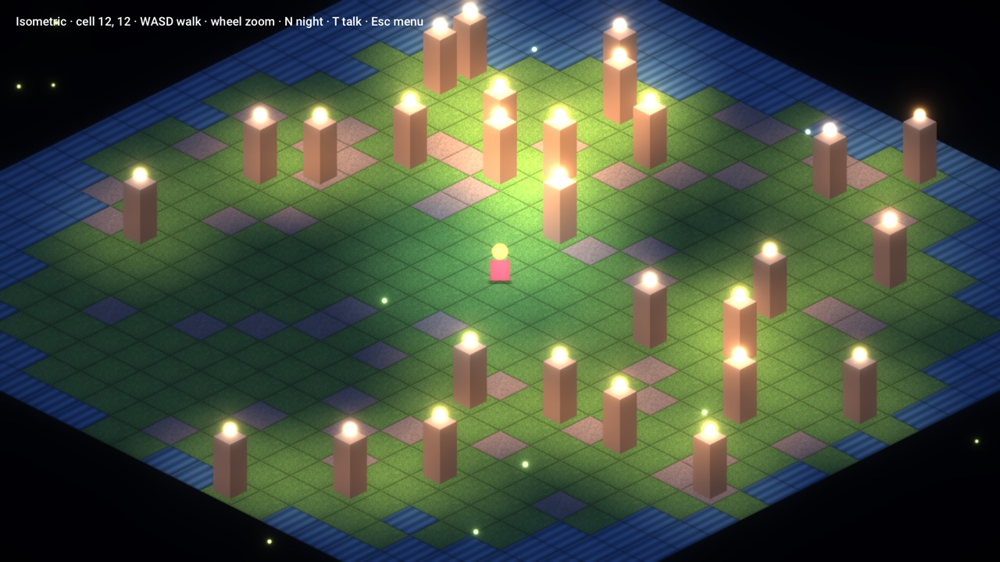
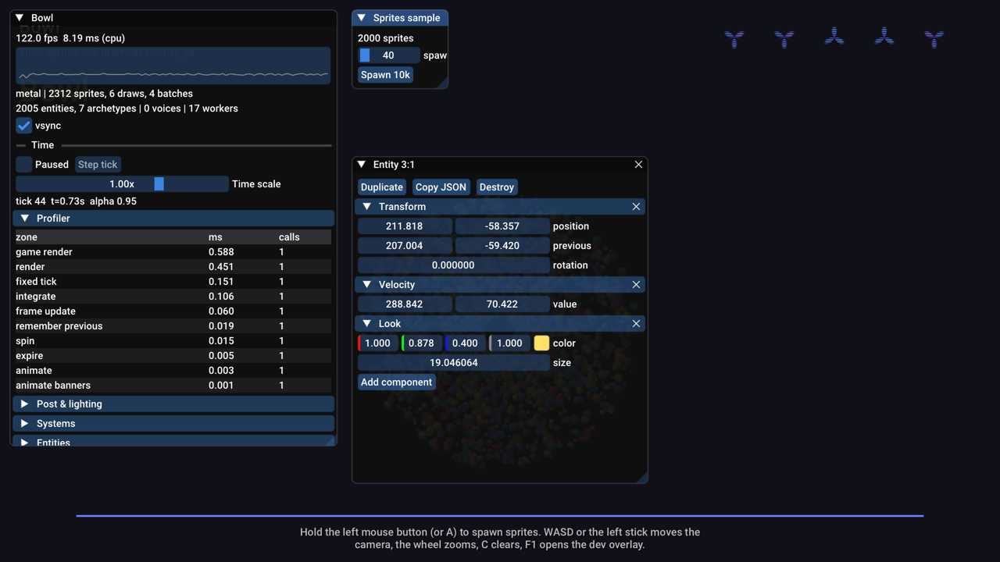
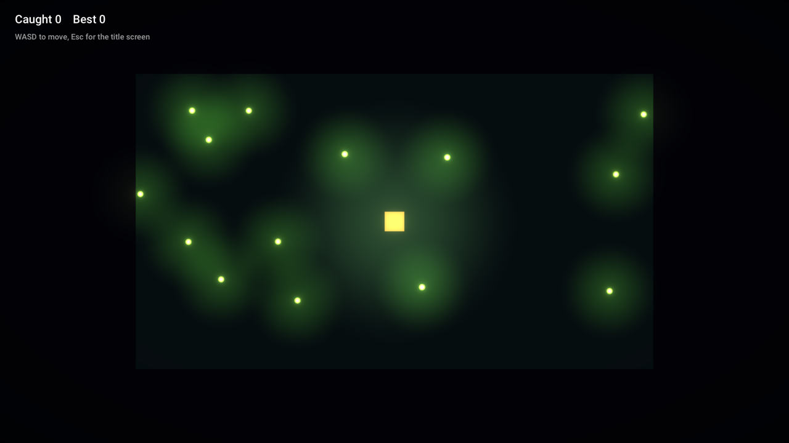
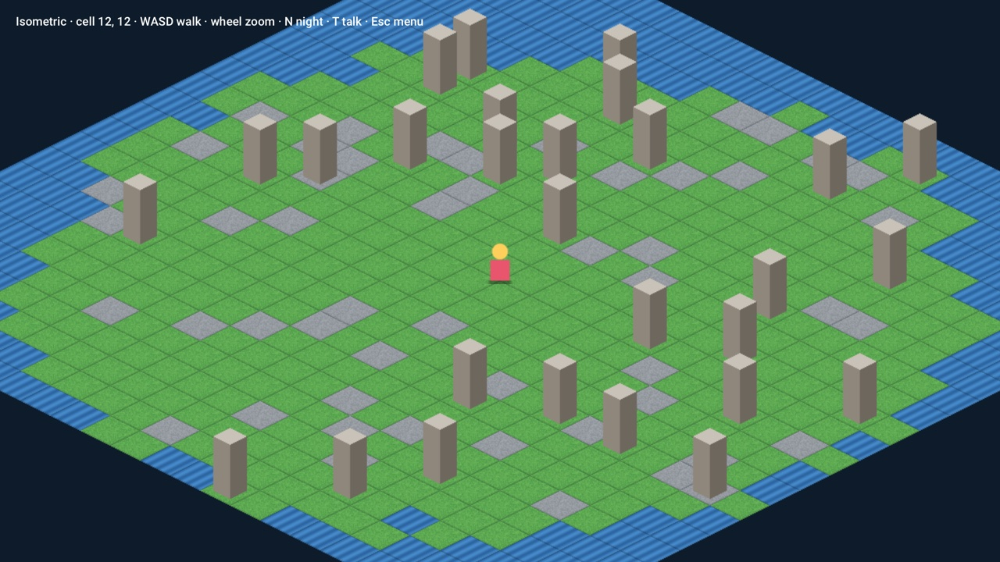
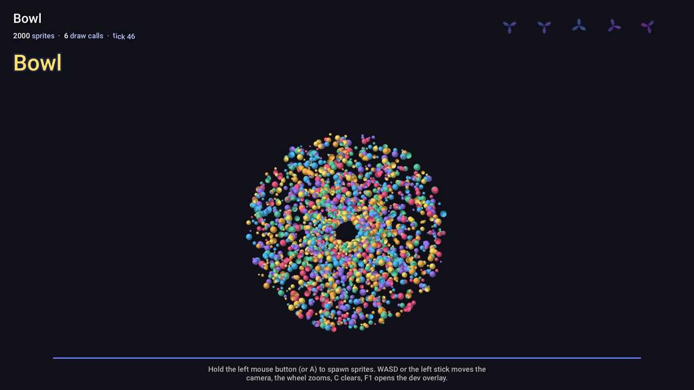

# PLACEHOLDERENGINENAME

A code-first 2D game engine in C++20, built on SDL3. One renderer for Vulkan, Metal and Direct3D 12, a parallel
archetype ECS, hot reload for assets, shaders and game code, and dev tools that run inside the game.

<p align="center">
  
  
</p>

You write the game in C++: a `Game` class with a few callbacks, components that are plain structs, systems that are
lambdas, assets loaded by path. The engine handles the loop, the GPU, audio, input and saving. In a dev build you can
change a texture, a shader, a Tiled map or the game's own code while it runs, and poke at any entity from the overlay.

It's built for 2D games with a lot going on, top-down and isometric included, that want to look good and save and
load their worlds without a pile of boilerplate.

(The name is a placeholder. It only shows up in `CMakeLists.txt`, the docs and a couple of log and window strings;
the code uses the namespace `ph`.)

## Features

**Core**
- Fixed-timestep simulation with interpolated rendering, so motion is smooth at any refresh rate
- Job system with deterministic chunking, a CPU profiler, logging, assertions
- Asset manager with virtual paths, mounts and hot reload; a failed reload keeps the last good version
- JSON (comments and trailing commas allowed in hand-written files), UTF-8, easing curves and tweens

**Entities**
- Archetype ECS: components are plain structs, queries are cached, `par_each` spreads work over every core
- A scheduler that runs non-conflicting systems in parallel and still gives the same result as running them in order
- Command buffers for structural changes, hooks, typed resources
- `PH_REFLECT` / `PH_COMPONENT` reflection: JSON save and load, prefabs, entity references that survive a reload
- Parent/child transforms

**Graphics**
- SDL_GPU renderer: Vulkan, Metal and Direct3D 12 from one code path
- Instanced sprite batches: one upload per frame, one draw call per texture run, depth or texture sorting
- HDR scene, bloom, exposure, contrast, saturation, tint, ACES tonemapping, vignette
- 2D lighting with an additive light map and ambient color
- Custom materials: your own fragment shader per batch, extra textures, a uniform block, four blend modes
- Shaders written once in GLSL and compiled to SPIR-V, MSL and HLSL by `ph-shaderc`
- TrueType text with kerning, wrapping, alignment and typewriter reveals, sharp at any size
- Aseprite sprite sheets and animation; Tiled maps (orthogonal and isometric, y-sorted, animated tiles)
- CPU particles; screenshots from the command line

**Everything else**
- Audio: 128-voice mixer, buses, pitch and pan, WAV and OGG sounds, streamed OGG music with gapless loops and
  crossfades
- Input: keyboard, mouse and up to four gamepads, named actions, rebinding saved to the player's settings
- Game UI: panels, buttons, checkboxes, sliders, progress bars, nine-slice art, dialogue boxes; mouse, keyboard and
  gamepad navigation
- Scene stack with fade transitions
- Collision: rectangles and circles, swept boxes that don't tunnel, raycasts, a spatial hash, `move_and_slide`
- Localization with fallbacks, placeholders and plurals
- Player settings stored in the OS's per-user folder

**Workflow**
- F1 dev overlay: frame graph, profiler, systems (timing, parallel batches, on/off), entity browser and inspector,
  assets with reload buttons, log, pause, single-step, slow motion
- Game-code hot reload on macOS and Linux: rebuild, and the new code takes over with the world kept
- Release builds with static SDL, precompiled shaders, `.app` bundles on macOS and `cmake --install` layouts

## Quick start

You need CMake 3.25 or newer and a C++20 compiler: Visual Studio 2022, Xcode 15 (Apple Clang), Clang 16 or GCC 13.
All other dependencies are downloaded at pinned versions and checked against a SHA-256. An installed SDL3 is used if
there is one; otherwise SDL3 is built from source.

```bash
git clone https://github.com/SireSoul/PLACEHOLDERENGINENAME.git
```

```bash
cd PLACEHOLDERENGINENAME
```

```bash
cmake --preset dev
```

```bash
cmake --build --preset dev
```

```bash
ctest --preset dev
```

Then run a sample (on Windows the executables are one folder deeper, in `RelWithDebInfo`):

```bash
./build/dev/samples/isometric/isometric --night
```

[docs/getting-started.md](docs/getting-started.md) has the per-platform setup, IDE tips and what each preset does.

## A game in one file

```cpp
#include "ph/app/main.hpp"
using namespace ph;

struct Position { Vec2 value; };
struct Velocity { Vec2 value; };
PH_COMPONENT(Position, value) // optional: savable, editable in the F1 inspector, survives hot reload
PH_COMPONENT(Velocity, value)

class MyGame final : public Game {
    gfx::SpriteBatch batch_;
    Asset<gfx::Texture> hero_;

    void init(Engine& engine) override {
        hero_ = engine.assets().load<gfx::Texture>("textures/hero.png"); // reloads when the file changes
        engine.fixed_schedule().par_each<Position, const Velocity>(
            "move", [](ecs::SystemContext& ctx, ecs::Entity, Position& p, const Velocity& v) {
                p.value += v.value * ctx.dt;
            });
    }
    void start(Engine& engine) override {
        engine.world().create(Position{{100, 100}}, Velocity{{40, 0}});
    }
    void render(Engine& engine) override {
        if (!hero_) return; // file missing or broken: the log says why, and it loads once it's fixed
        batch_.begin(engine.camera());
        engine.world().each<const Position>([&](const Position& p) { batch_.draw(*hero_, p.value); });
        engine.renderer().submit(batch_);
    }
};

PH_MAIN(MyGame)
```

```cmake
add_executable(my_game main.cpp)
ph_add_game(my_game ASSETS assets)
```

The [tutorial](docs/tutorial.md) builds a complete small game from here, one feature at a time.

## Samples

| | |
| --- | --- |
|  | **`tutorial`**: Fireflies, the game the [tutorial](docs/tutorial.md) builds. Scenes, a title menu, ECS systems, collision, lighting, particles, sound and a saved high score. |
|  | **`isometric`**: a y-sorted isometric map to walk around, with collision, a night mode (lights, bloom, fireflies), a pause menu and a dialogue box. Flags: `--night`, `--menu`, `--dialogue`. |
|  | **`sprites`**: an ECS stress test with thousands of bouncing sprites, a custom shader, animated sprite sheets, audio and a custom dev tool window. Built with game-code hot reload. |

## Documentation

Start at [docs/README.md](docs/README.md), the full index. The main entry points:

| | |
| --- | --- |
| [Getting started](docs/getting-started.md) | Toolchains for Windows, macOS and Linux; building, running, IDEs |
| [Tutorial](docs/tutorial.md) | Make a complete game, step by step |
| [Architecture](docs/architecture.md) | How the modules fit together, the frame, threading rules |
| [Guides](docs/README.md#guides) | One page per system: ECS, rendering, shaders, assets, text, sprite sheets, tilemaps, audio, input, UI, scenes, collision, saving, hot reload, dev tools, packaging and more |
| [Reference](docs/README.md#reference) | CMake options and functions, command-line flags, project layout, conventions |
| [Troubleshooting](docs/troubleshooting.md), [FAQ](docs/faq.md) | Common problems and questions |
| [Roadmap](docs/roadmap.md) | What's done and what's next |

## Platforms

| Platform | GPU backend | Status |
| --- | --- | --- |
| Windows 10 and 11 | Direct3D 12 (Vulkan also works) | Built and tested on CI; every CI run renders a sample on D3D12 through WARP |
| macOS | Metal | Built and tested on CI; the main development machine |
| Linux (X11, Wayland) | Vulkan | Built and tested on CI |
| iOS, Android | Metal, Vulkan | SDL3 supports them and the entry point is ready; packaging isn't set up yet |
| Web | waiting on WebGPU support in SDL_GPU | Planned |

[docs/guides/platforms.md](docs/guides/platforms.md) has the details.

## Repository layout

```
engine/      the engine: core, ecs, platform, gfx, audio, physics, ui, app (+ engine assets)
tools/       ph-shaderc, the shader compiler
samples/     tutorial, isometric, sprites
tests/       unit tests (doctest) and an ECS benchmark
cmake/       build helpers: dependencies, compiler flags, shaders, ph_add_game
docs/        the documentation
```

[docs/reference/project-layout.md](docs/reference/project-layout.md) goes through it file by file.

## Status

Early, but everything listed above builds, is tested on three operating systems and runs. The API will keep
changing while the first game is built on it; [CHANGELOG.md](CHANGELOG.md) records what changed.

## Contributing

[CONTRIBUTING.md](CONTRIBUTING.md) covers the workflow, code and comment style, and how to run the same checks as CI.

## License

No license has been chosen yet; until one is, all rights are reserved. Third-party code keeps its own license: SDL
(zlib), stb (public domain or MIT), glslang (BSD-3-Clause and others), SPIRV-Cross (Apache-2.0), Dear ImGui (MIT),
doctest (MIT) and the Roboto font (Apache-2.0, in `engine/assets/fonts`).
