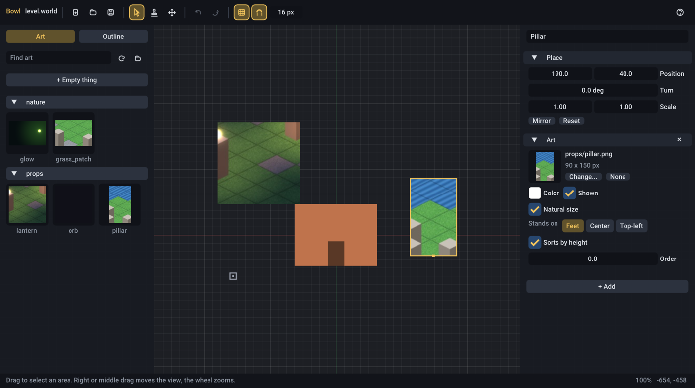
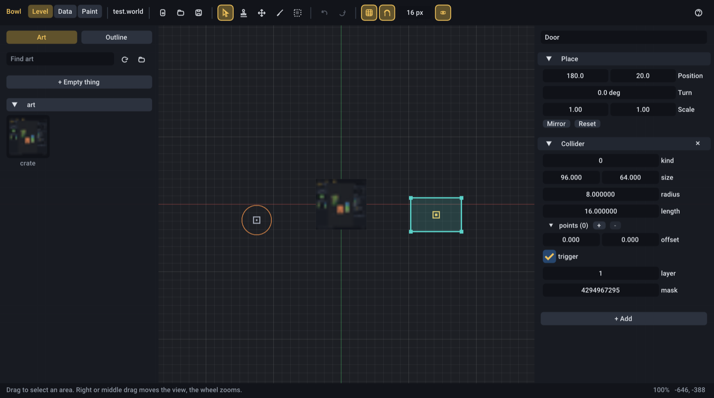
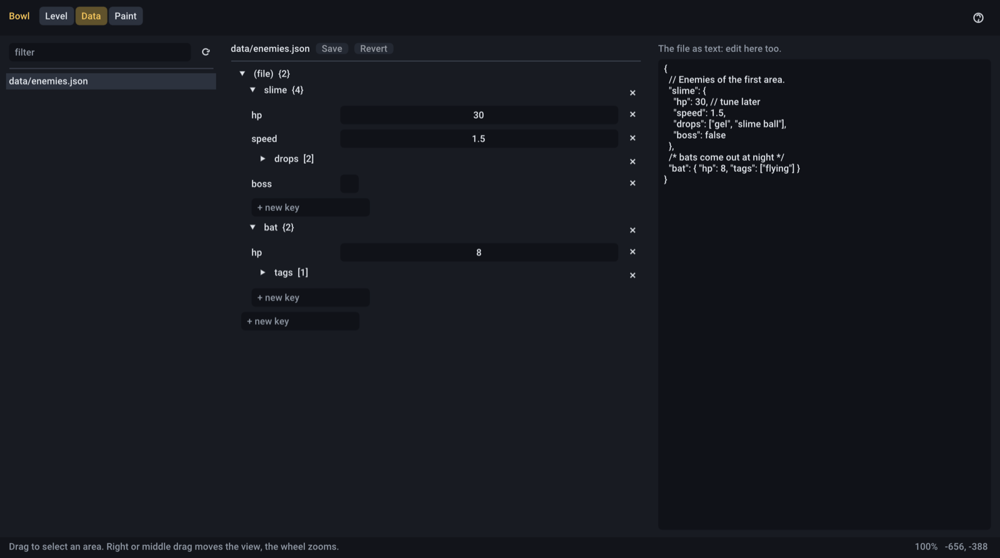
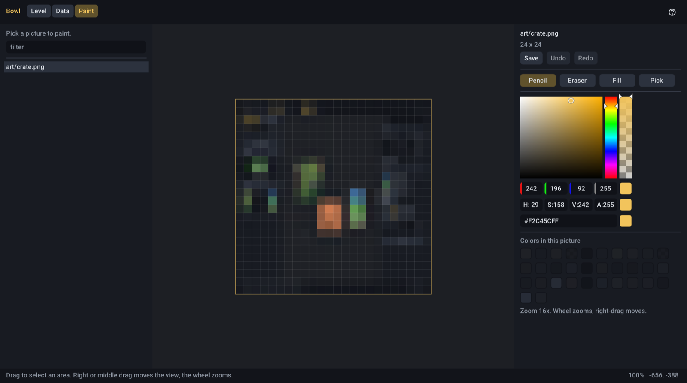

# Bowl Editor

Bowl Editor lays out levels: it places art and markers in a `.world` file that the game loads. It draws with the
game's own renderer, so what you see is what the game shows.

<p align="center"></p>

## Starting it

The editor is built with the engine in dev builds (`build/dev/editor/bowl-editor`).

```bash
./build/dev/editor/bowl-editor assets/levels/town.world --game build/dev/my_game/libmy_game_code.so
```

| Argument | |
| --- | --- |
| `level.world` | The level to open. Without one, it starts with an empty, untitled level |
| `--assets <folder>` | Where the art is. By default, the `assets` folder the level is in, or `./assets` |
| `--game <library>` | The game's hot-reload code library, so the game's own components can be added and edited. On Windows, `<game>_editor_code.dll` |
| `--data`, `--paint` | Start in the Data or Paint workspace with its first file open |
| `--content [collection [id]]` | Start in the Content workspace, on that collection and record |
| `--select <name>` | Select the thing with this name at startup |
| `--resave` | Open the level, save it in the current format and quit |
| `--attach [profiler\|systems\|entities]` | Start in the Game workspace, attached to the first game running on this computer, on that pane |

The first time it opens, a short welcome explains the basics. Rest the mouse on any button for what it does and its
key; **F1** lists every key.

## The screen

The editor has five workspaces, switched at the top left: **Level** (Ctrl+1) lays out levels, **Content** (Ctrl+5)
edits the game's content as forms, **Data** (Ctrl+2) edits its data files as JSON, **Paint** (Ctrl+3) paints its art,
and **Game** (Ctrl+4) looks inside a running game. The rest of this section is the Level workspace.

- **Top bar:** new, open and save; the tools (Select, Place, Move the view, Brush, Region); undo and redo; the grid,
  snapping and the grid size; showing collision shapes; help.
- **Left: Art and Outline.** Art shows every picture, Tiled map (`.tmj`, `.tmx`) and prefab (`.prefab`) in the assets
  folder, grouped by folder, with a search box. Outline lists everything in the level, with what's inside what, and
  an eye and a padlock on each row (see [Hiding and locking](#hiding-and-locking)).
- **Right: the inspector.** What's selected: its name, where it is, its art, and any other components.
- **Bottom: the status line.** What a click would do right now, short messages ("Saved town.world"), the zoom and
  the mouse's position in the world.

## Placing things

Pick a picture on the Art tab, then click the level: every click places another. A see-through preview follows the
mouse. **Esc** goes back to selecting. You can also drag a picture from the shelf straight into the level.

- Things snap to the grid. Hold **Alt** to place one exactly where the mouse is.
- Pictures stand on their **feet**: the middle of their bottom edge. Change that in the Art card ("Stands on").
- **+ Empty thing** places a marker with nothing drawn: spawn points, triggers, the anchor of a group.
- A **prefab** places a copy of its entities, its first one where you click. The copy is the level's own from then on:
  changing the prefab file later doesn't change copies already placed.

### Maps

A Tiled map from the shelf goes in the level as a thing with a `gfx::Map` component, its corner where you click (the
top-left of its bounding box, as in Tiled). It starts **locked**, so clicks go to what you put on it rather than
selecting the map; unlock it in the Outline to move it.

With a map in the level, snapping follows the map's cells instead of the square grid: things land in the middle of a
cell (a diamond on isometric maps), and the cell under the mouse is outlined. Tall layers sort with the art you place
by their bottom edge, so a character in front of a pillar draws in front of it, the same as in the game.

## Selecting and arranging

| | |
| --- | --- |
| Click | Select |
| Shift-click | Add to or take from the selection |
| Drag on empty ground | Select everything in the box |
| Drag a thing | Move it and everything selected, snapped |
| Alt-drag | Move copies, leaving the originals in place |
| Arrows (Shift) | Nudge one unit (a grid step) |
| Q / E (Shift) | Turn 15 degrees (1 degree) |
| Ctrl+D, Ctrl+C, Ctrl+X, Ctrl+V | Duplicate, copy, cut, paste at the mouse |
| Ctrl+G, Ctrl+Shift+G | Group, ungroup |
| Delete | Remove, with anything inside |

With several things selected, the inspector offers **Group**, **Duplicate**, **Delete** and lining them up by their
left, center, right, top, middle or bottom edges.

**Groups.** A group is a thing with others inside it; moving, turning or scaling it carries them along. In the
Outline, drag one thing onto another to put it inside, or onto the empty space below to take it out. Either way it
stays where it is in the world.

## Hiding and locking

Each row in the Outline has an eye and a padlock, and the right-click menu has the same:

- **Hide** takes a thing out of the editor's view, to work on what's behind it. Only the editor hides it: the game
  still shows it. (Whether the *game* shows a picture is the Art card's **Shown**.)
- **Lock** makes clicks in the scene go past a thing (and box selections leave it out), so a backdrop doesn't get
  picked or dragged by accident. Select it in the Outline to change it.

Both apply to everything inside a group, are saved with the level under `"editor"` (games ignore it), and can be
undone.

## Looking around

The right or middle mouse button drags the view, and so does the left button with the Move tool (H) or while holding
Space. The wheel zooms toward the mouse. **F** shows the selection, **Home** the whole level. Double-clicking a row in
the Outline shows that thing.

## The inspector

- **Name**, at the top: shown in the Outline, and a way for the game to find things.
- **Place:** position, turn (in degrees) and scale, with Mirror and Reset.
- **Art:** the picture (Change..., or drop one from the shelf onto the preview), a tint color, shown or hidden, natural
  size or a size of its own, where it stands, whether it sorts by height (lower on screen draws in front), and its
  draw order.
- **Other components** each get a card with their fields and a remove button. **+ Add** gives the thing any component
  the editor knows: the engine's (Art, Particles) and, with `--game`, the game's own.

### The game's own components

A level often carries components only the game knows: a spawn point's kind, a door's destination. Start the editor
with `--game` pointing at the game's hot-reload library (`HOT_RELOAD` in `bowl_add_game`) and those components get
proper fields, and can be added from **+ Add**. The editor never runs the game's code; loading the library only
registers its `BOWL_COMPONENT` types.

Without `--game`, those components are kept as JSON: shown as text you can edit, and written back exactly when
saving. Opening and saving a level never loses anything.

On Windows a game's code library is tied to the game's own executable (it imports the engine from it), so the build
makes a second copy for the editor: `<game>_editor_code.dll`, next to the editor. Pass that to `--game`.

## Regions and collision shapes

<p align="center"></p>

Every `physics::Collider` in the level is drawn on it: triggers (regions) tinted teal, solid shapes outlined in orange.
**C** or the eye button hides them.

- **The Region tool (R):** drag out an area, or click for a square one. It becomes a thing named "Region 1" (and so on)
  with a trigger collider: rename it, and the game finds it by name, or add the game's own components to it (a door's
  destination, a spawn area's kind).
- **Resizing:** select a box or circle collider and drag its handles; the opposite corner stays put, and the grid
  applies.
- Everything else about a collider (its kind, a polygon's points, triggers, layers) is in its card on the right.

## Painting where it stands

The **Brush tool (B)** paints on a picture right in the level: click and drag on placed art, and the pixel under the
mouse changes, through the thing's position, rotation, scale and art region. Every placed copy of that picture
changes with it, and a running game sees it too. The colors and tools are the Paint workspace's.

## The Content workspace

The **Content** tab (**Ctrl+5**) edits a game's content as forms: its items, people, shops, events and sounds, or
whatever the game keeps in data files. Collections are on the left with how many records each has; pick one, then a
record below it, and its form is on the right.

- **+**, **copy** and **bin** add a record (with a fresh id), copy the one picked, and remove it. The filter box finds
  records by name or id.
- Every field says what it's for when the mouse rests on its name. A field in a dimmer color isn't in the file yet:
  its default shows, and changing it writes it.
- **References** to other records (an event's person, a shop's stock) are menus of the ids there, and the arrow beside
  one goes to it. **Pictures** show thumbnails; **sounds** have a play button, and **+** makes a new sound event from
  an audio file (WAV or Ogg), copied into `sounds/clips/`. **Maps** and **spawn points** are menus read from the maps
  themselves, and **On the map...** shows the map so a spot can be clicked.
- **Lists** (lines of dialogue, schedule stops, actions) have up, down, copy and remove on each item; items with
  kinds (an action that says something or gives an item) are added from a menu of kinds, and changing an item's
  kind keeps the values that carry over.
- **Problems** (repeated or missing ids, references to things that aren't there, pictures and sounds that aren't
  there) are counted beside each collection and listed at the top of its form; click one to go to its record.
- **Ctrl+S** saves every changed file, **Ctrl+Z** and **Ctrl+Shift+Z** undo and redo. Like the Data workspace, edits
  keep each file's comments and layout, and a running game reloads the file when it's saved. Changes not saved when
  the editor closes are saved then. **F5** looks for new files and schemas.
- Keys in a record that the schema doesn't know are kept, and shown at the bottom as JSON.

**Sounds** are always there: every `.sound` file in the assets, its clips, loudness and pitch (one value or a range
picked from each time), bus, looping and limits. **+** makes a new one in `sounds/`.

**Maps** are always there too: every Tiled map in `maps/`, shown as the game draws it, with the markers on its
`markers` layer. **+ Add a marker** places one (pick its kind, click the map); click a marker to pick it, drag it to
move it (Alt for off the grid), Delete removes it. On the right are its name, place, size and the properties its kind
has, as a form: a shop's id is a menu of the shops, an exit's spawn point a menu of the spawn points on the map it
goes to. Problems (a property naming nothing, two spawn points with one name) are listed. **+** in the list of maps
makes a new map, a copy of the one picked without its markers. Tiles are still painted in Tiled; edits here keep the
rest of the file as it was, and a running game reloads the map when it's saved.

**Play** (and **Play here** on a map) saves and starts the game, when the schema says how (`"play"`, below).

### Schemas

A schema is a JSON file in the assets whose name ends in `.schema.json`. It lists **collections** (where records are)
and **types** (what a record holds):

```json
{
  "collections": [
    { "id": "items", "title": "Items", "file": "data/items.json", "list": "items", "type": "item",
      "label": "name", "picture": "icon", "help": "Everything the player can carry." },
    { "id": "settings", "title": "Game", "file": "data/game.json", "type": "settings" }
  ],
  "types": {
    "item": { "fields": [
      { "key": "id", "type": "id" },
      { "key": "name", "type": "text" },
      { "key": "icon", "type": "picture" },
      { "key": "stack", "type": "int", "min": 1, "max": 999, "default": 99, "help": "Most in one slot." }
    ] }
  }
}
```

Pictures can be pictures or Aseprite sprite sheets (`.json`), shown by their first frame.

A collection is the list under `list` in `file`, or, without `list`, the whole file as one record. `label` and
`picture` name the fields shown in the list of records; the field named `id` (or `id_key`) is what references use.

A field has a `key`, a `type`, and optionally a `label`, `help` and `default`. The types:

| Type | Holds | Options |
| --- | --- | --- |
| `text` | text | `multiline`; `suggest`: a name shared by fields whose values are offered as suggestions (flags) |
| `id` | the record's id | |
| `int`, `number` | numbers | `min`, `max`, `step` |
| `bool` | on or off | |
| `choice` | one of `options` | `free`: any text too |
| `choices` | a list of some of `options` | `free` |
| `time` | minutes after midnight, shown as a time of day | past midnight is fine |
| `ref` | the id of a record in the collection `to` | `optional`, `free` (any text too) |
| `picture`, `sound` | an asset path | |
| `audio` | an audio file | `relative`: from the record file's folder, as sound events want |
| `map` | a map's name, from the `maps` folder (or `folder`) | |
| `spawn` | the name of a spawn point on the map named by the field `area` beside it | |
| `cell` | `[x, y]` in cells of the map named by the field `area` beside it | |
| `color` | `"#rrggbb"` | |
| `range` | a number, or `[min, max]` | `min`, `max`, `step` |
| `list` | a list of `of` (a field without a key) | |
| a type's name | an object with that type's fields | |

A type is `{"fields": [...]}`. One with **variants** also has a `tag` (the key saying which variant it is) and
`variants`, each with a `label` and its own `fields`; a field of type `variant` in `fields` says where the menu of
variants goes, and the variant's fields follow it. `summary` lists the fields shown in the title of a list item. A
type can also be an alias for a field with settings: `"days": {"base": "choices", "options": ["mon", ...]}` makes
`{"type": "days"}` mean that.

Two more keys at the top of a schema:

```json
{
  "play": { "command": "../../build/dev/game", "args": ["--new"] },
  "markers": {
    "shop": { "label": "Shop counter", "area": true, "fields": [{ "key": "shop", "type": "ref", "to": "shops" }] },
    "sign": { "label": "Sign", "fields": [{ "key": "text", "type": "text", "multiline": true }] }
  }
}
```

`play` is the game to start, from the schema's folder (`.exe` is added on Windows), with `--area <map>` added for
Play here. `markers` are the kinds of map markers besides Bowl's own `spawn` and `exit` (which a schema can redefine):
an `area` one covers cells, the others are points in the middle of a cell, and `fields` are its Tiled properties.

## The Data workspace

<p align="center"></p>

Every `.json` and `.prefab` file in the assets folder, on the left. The open file shows twice: as a tree of values
you can change, and as its text.

- Numbers drag or take typing, text is a text field, on/off is a checkbox. Lists have **+** to add an item (a copy of
  the last) and every value has **x** to remove it; objects have a **+ new key** box. An empty value offers a type.
- **Changes keep the file as it was written:** comments, spacing, key order and trailing commas stay, because only
  the value that changed is rewritten (`json::TextDocument` does this, and is there for your own tools too).
- The text can be edited directly as well. While it doesn't parse, the tree shows where the mistake is.
- **Ctrl+S** saves, **Ctrl+Z** and **Ctrl+Shift+Z** undo and redo, **Revert** goes back to the file on disk. A
  running game reloads the file when it's saved.

## The Game workspace

The **Game** tab (**Ctrl+4**) attaches the editor to a game running on this computer, from a dev build: the game's
own window keeps playing, and this one looks inside it. Running games are listed on the left; click one to attach,
click it again to let go. Nothing on a network can attach: the game listens on this computer only, with a key in a file
only you can read.

- **Profiler:** frame times as a graph, and the profiler's zones averaged over the last second, slowest first. Pause,
  step one fixed tick, or slow the game down or speed it up.
- **Systems:** both schedules, each system with its batch, its time and a switch to turn it off in the game. A system
  in the accent color starts a new batch: rest the mouse on it for why. **Access by component** is the same as a table.
  The editor keeps the last schedules a game sent, so this pane, and an **In the game** note under a thing's components
  in the Level tab ("Transform: written by integrate; read by draw"), still say what the game does when it isn't
  running.
- **Entities:** every entity, by name or what it's made of, a page at a time, with a filter that matches names and
  component names. Pick one and its components show as values, changing as the game runs; change one and the game's
  changes with it. Components that point at other entities are shown but not edited, since their JSON holds those
  references as nothing.

## The Paint workspace

<p align="center"></p>

Pick a picture on the left to paint it on a big canvas with a pixel grid.

| Tool | Key | |
| --- | --- | --- |
| Pencil | B | Paints pixels; fast strokes have no gaps |
| Eraser | E | Makes pixels transparent |
| Fill | F | Fills the area of one color |
| Pick | I, or hold Alt | Takes a color from the picture |

The palette starts with the colors already in the picture, most used first. The wheel zooms toward the mouse,
right-drag moves. **Ctrl+Z** / **Ctrl+Shift+Z** undo and redo strokes, **Ctrl+S** writes the PNG. Every stroke shows in
the level (and a running game) at once; switching pictures saves the one you were painting.
## Saving and safety

- **Ctrl+S** saves, **Ctrl+Shift+S** saves under a new name. A running game picks the level up by itself (it's an
  ordinary hot-reloading asset).
- **Undo and redo** (Ctrl+Z, Ctrl+Shift+Z or Ctrl+Y) cover everything, keeping what was selected.
- New and Open ask before throwing away unsaved changes.
- When the editor closes with unsaved changes, they're kept in `<level>.world.autosave` and offered back the next time
  the level is opened.
- Preferences (grid, snapping, grid size) are remembered in the editor's own settings file in your user folder.

## Loading levels in the game

A `.world` file is an asset:

```cpp
Asset<ecs::WorldFile> town = engine.assets().load<ecs::WorldFile>("levels/town.world");
serial::Context ctx{&engine.assets()};
ecs::load_entities(engine.world(), town->document, ctx);
```

Draw what the level placed with `gfx::draw_maps(world, batch, time)` and `gfx::draw_sprites(world, batch)`, into
the same batch so they sort together, after the transform systems have run
(`ecs::add_transform_systems(engine.frame_schedule())`), or draw entities your own way. See
[saving.md](saving.md#world-files) for the file format.

## The engine overlay

The engine's own overlay (profiler, systems, log) is on **F12** in the editor, since F1 is the editor's help.
