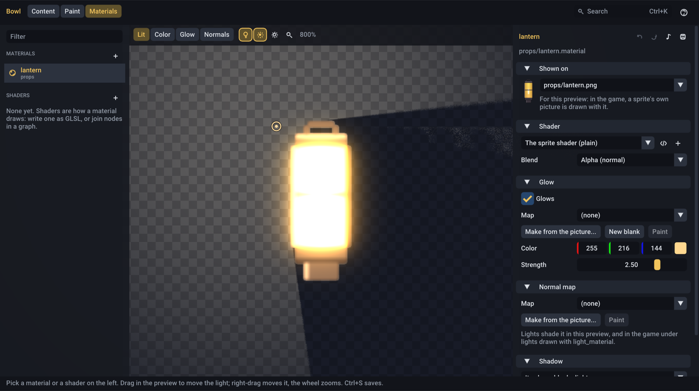
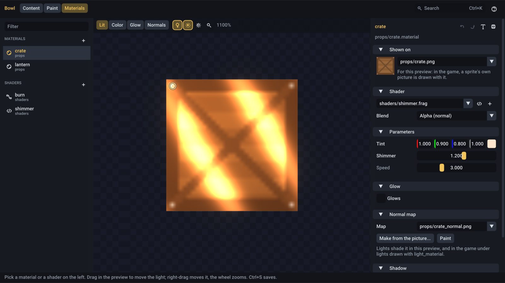
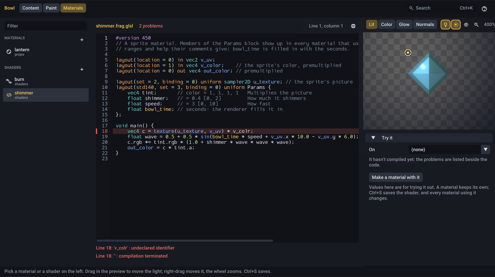
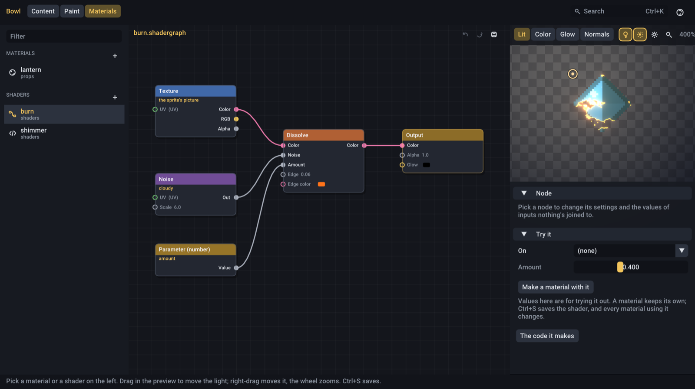

# Materials and shaders

How things look beyond their pixels: a lantern that glows at night, a stone wall whose bumps catch the torchlight, water
that ripples, an enemy that burns away when it dies. This guide walks through making each of them in Bowl Editor's
**Materials** workspace and using them in a game.

- [The three kinds of file](#the-three-kinds-of-file)
- [A glowing lantern](#a-glowing-lantern)
- [Bumps that catch the light](#bumps-that-catch-the-light)
- [Writing a shader](#writing-a-shader)
- [A shader without code: the graph](#a-shader-without-code-the-graph)
- [Using materials in the game](#using-materials-in-the-game)
- [When something looks wrong](#when-something-looks-wrong)

<p align="center"></p>

## The three kinds of file

| File | What it is | Made with |
| --- | --- | --- |
| `lamp.material` | A picture's look: which shader draws it and with what values, its glow, its normal map, its shadow | The material form |
| `water.frag.glsl` | A shader: a small program that decides each pixel's color | The code editor, or any text editor |
| `burn.shadergraph` | A shader made by joining nodes, with no code. Saving it writes `burn.frag.glsl` beside it | The graph canvas |

A sprite uses one material; many sprites can share it. A material uses one shader (or none: the plain sprite shader);
many materials can share it, each with its own values. Change the shader and every material using it changes.

Open the workspace with the **Materials** tab or **Ctrl+6**. Materials are listed on the left above shaders; **+** on
either list makes a new one.

## A glowing lantern

The lantern is a normal picture, `props/lantern.png`. We want its glass and flame to stay bright when the level is dark,
and to bloom.

1. **Make the material.** Click **+** next to Materials, pick `props/lantern.png`, and click **Make it**. The editor
   writes `props/lantern.material` beside the picture and opens it. (From the Level tab, the **+** beside an Art card's
   Material does the same for that picture and puts the material on it.)
2. **Turn on the glow.** In the **Glow** card, tick **Glows**. With no map, the picture glows wherever it's bright,
   which is often enough for a flame. The preview shows it under a light; drag in the preview to move the light.
3. **Glow only where it should.** For more control, click **Make from the picture...**. The picture's colors are listed:
   click the ones that glow (the flame's yellow and white, the glass's orange). Or tick **And everything brighter than**
   and move the slider. The preview shows the result as you choose. **Save** writes `props/lantern_emissive.png` and
   uses it.
4. **Tune it.** **Color** tints the glow; **Strength** sets how bright it is. Above 1 is brighter than white, which is
   what blooms. Try 2 to 4 for a lamp.
5. **Paint the details.** **Paint** opens the glow map in the Paint workspace with the lantern faintly beneath it. Paint
   bright where it glows and leave the rest see-through (or black). **Ctrl+S** in Paint saves it, and the material
   shows it at once.
6. **Give it a shadow.** In **Shadow**, pick **Its shape blocks light**. In the preview the lantern now casts a shadow
   away from the light.
7. **Save** with **Ctrl+S**.

The preview's bar switches between **Lit** (as the game draws it), **Color** (no light or glow), **Glow** and
**Normals** (each map alone). The bulb turns the light off and on, the sun turns bloom off and on, and the gear sets the
light's color, size and height and how dark the rest is.

To see it in a level, put the material on a placed picture (Level tab, Art card, **Material**) and press **L** for the
light preview: the level goes dark and a light follows the mouse.

## Bumps that catch the light

A normal map tells lights which way each pixel faces, so a flat sprite looks carved: a crate's planks, a wall's stones,
a coin's rim.

<p align="center"></p>

1. Open (or make) the material for the picture.
2. In **Normal map**, click **Make from the picture...**.
3. Move the light around the preview while you set:
   - **Bevel**: how far in from the edge the shape rises. 2 to 4 pixels suits most pixel art; 0 uses only brightness.
   - **Brightness**: how much lighter pixels stand out. Raise it for stones and planks, lower it for smooth things.
   - **Strength**: how steep the slopes look.
   - **Dents instead of bumps**: for engravings and holes.
4. **Save** writes `<picture>_normal.png` and uses it. Paint it by hand from there if you like: **Paint** opens it with
   the picture beneath.

The edges of the picture itself never bevel, so tiles that fill their whole picture still join up.

Normal maps you made elsewhere work too, if green points up (OpenGL's convention, what most tools make). Pick one in
the **Map** menu.

## Writing a shader

A shader is the code that colors each pixel of a sprite. Write one when a material needs to move, warp or change:
shimmering water, a hologram, a hit flash.

<p align="center"></p>

1. Click **+** next to Shaders, name it (`shaders/shimmer`), choose **Code**, and click **Make it**. It starts as a
   working example.
2. Change it. It compiles each time you stop typing. A mistake is marked on its line in red; rest the mouse on the line
   number, or read the list under the code, for what's wrong. Click a problem to go to its line. Until it's fixed, the
   preview shows the last version that worked.
3. The preview on the right shows it on a picture (**On**, or a test gem). Its parameters are below, with values to try.
4. **Ctrl+S** saves. Every material using it, in the editor and in a running game, changes.
5. **Make a material with it** makes a material that uses the shader with the values you tried.

### Parameters

Anything a material should be able to change goes in the `Params` block, with a comment saying what it is:

```glsl
layout(std140, set = 3, binding = 0) uniform Params {
    vec4 tint;       // color = 1, 1, 1, 1   Multiplies the picture
    float shimmer;   // = 0.4 [0, 2]         How much it shimmers
    float speed;     // = 3 [0, 10]          How fast
    float bowl_time; // seconds: the renderer fills it in
};
```

- `color` makes it a color picker in the material.
- `= ...` is its value when a material doesn't set it.
- `[0, 10]` makes it a slider with that range.
- The rest of the comment is its help, shown when the mouse rests on its name.

`bowl_time` (the seconds) and `bowl_screen` (the screen's size) are filled in for you. Extra textures are declared at
bindings 1 to 3, and each material picks a picture for them by name:

```glsl
layout(set = 2, binding = 1) uniform sampler2D u_noise; // Clouds to scroll over it
```

The rest of what a shader receives (its inputs, and why colors are premultiplied) is in
[shaders.md](shaders.md#writing-a-sprite-material).

## A shader without code: the graph

A shader graph builds a shader from nodes, each doing one thing, joined by links. Here's a sprite that burns away, the
kind of effect for a defeated enemy or a spell.

<p align="center"></p>

1. Click **+** next to Shaders, name it (`shaders/burn`), choose **Graph**, and click **Make it**. It starts with the
   sprite's picture times its color, joined to the **Output**.
2. **Right-click** empty space and type `noise`; pick **Noise**. Click it and, on the right, set **Kind** to *cloudy*
   and **Scale** to 6.
3. Right-click again and add **Dissolve** (under Effect).
4. Join them: drag from the **Multiply**'s **Out** to the Dissolve's **Color**, from the Noise's **Out** to its
   **Noise**, and from the Dissolve's **Color** to the Output's **Color** (which replaces the old link).
5. Add a **Parameter (number)**, name it `amount`, and join its **Value** to the Dissolve's **Amount**. Now each
   material sets how far it's burnt, and the game can change it.
6. Under the preview, slide **Amount** from 0 to 1 to watch it burn, with a glowing edge in the Dissolve's **Edge color**.
7. **Ctrl+S** saves `burn.shadergraph` and `burn.frag.glsl` beside it. **Make a material with it** gives you a material
   to put on sprites.

Working on the canvas:

| | |
| --- | --- |
| Right-click empty space | Add a node (type to find it) |
| Drag from a pin to another | Join them |
| Drag from a pin into empty space | Add a node there, already joined |
| Drag a joined input | Move its link to another output, or drop it to remove it |
| Click a node | Its settings, and values for the inputs nothing's joined to, on the right |
| Drag a node, drag on empty space | Move it, pick everything in the box |
| Delete, Ctrl+D, F | Remove the picked nodes, copy them, show everything |
| Wheel, middle or right drag | Zoom, move the view |
| Ctrl+Z, Ctrl+Shift+Z | Undo, redo |

A pin's color says what it carries: grey a number, green a vector (two numbers, like a position in the picture), yellow
a color without alpha, pink a color. Any output can join any input: a number joined to a color affects all of it, a
vector joined to a number gives its first part.

Some recipes:

| Effect | Nodes |
| --- | --- |
| Flowing water | **Scroll** into a **Texture** (the sprite's picture, or an extra one), mixed with a second scrolling the other way |
| Heat haze, a waving flag | **Wave** into the **Texture**'s UV |
| A hit flash | **Mix** the texture's **RGB** toward white by a **Parameter (number)** the game sets for a moment, into the Output's **Color**, with the texture's **Alpha** into the Output's **Alpha** |
| A selected outline | **Outline** times a **Color**, **Add**ed to the texture's color |
| A flickering torch | **Flicker** times the texture's color, into the Output's **Glow** |
| A hologram | **Stripes** on **Screen position** times a cyan **Color**, plus **Noise** scrolling over **Time** |

**The code it makes** shows the GLSL the graph writes, a good way to learn shader code.

## Using materials in the game

### Sprites placed in the editor

A level's sprites keep their materials: load the level as usual and draw it through `gfx::SpriteLayers` so the glow,
normal maps and shadows reach the renderer:

```cpp
gfx::SpriteLayers layers; // a member of your game or scene

void render(Engine& engine) override {
    layers.begin(engine.camera());
    gfx::draw_maps(engine.world(), layers.scene, static_cast<f32>(engine.time()));
    gfx::draw_sprites(engine.world(), layers);
    layers.submit(engine.renderer());
}
```

`gfx::draw_sprites(world, batch)` with a plain batch still draws each sprite's shader, but not its glow, normal map or
shadow.

### Sprites made in code

```cpp
Asset<gfx::SpriteMaterial> lamp = engine.assets().load<gfx::SpriteMaterial>("props/lantern.material");
world.create(ecs::Transform2D{{40, 80}}, gfx::Sprite{.texture = lantern_png, .material = lamp});
```

Drawing your own way, `layers.draw(texture, sprite, lamp.get())` draws one sprite with everything its material has.

### Light, darkness and bloom

The glow shows with nothing else. To see it bloom, and to make the night that it glows in:

```cpp
gfx::PostSettings& post = engine.renderer().post();
post.bloom = true;                          // bright glow spreads
post.lighting = true;                       // the scene is dark except where lights are
post.ambient = {0.2f, 0.22f, 0.35f, 1};     // how dark

// Lights that shade normal maps and are blocked by shadows. torch_look and lights are members:
torch_look = gfx::light_material(engine.assets(), {.normals = true, .shadows = true}); // once, in init

// every frame

lights.begin(engine.camera(), gfx::SpriteSort::None, gfx::BlendMode::Additive, &torch_look);
lights.draw(&engine.renderer().light_texture(), {.position = torch, .size = {300, 300}, .color = {1, 0.8f, 0.6f, 1}});
engine.renderer().submit_light(lights);
```

Normal maps and shadows only show under lights drawn with `light_material`. See
[rendering.md](rendering.md#2d-lighting) for lighting in full.

### Changing a parameter while the game runs

```cpp
const f32 burnt[] = {progress};       // 0 to 1
death_material->set_param("amount", burnt);
```

This changes it for every sprite using that material. For one enemy burning on its own, give it a material of its own
(load another `.material` file, or copy the `gfx::SpriteMaterial`).

### Hot reload

In a dev build everything updates while the game runs: saving a material, a shader, a graph, or one of their pictures
in the editor (or anywhere else) changes the running game within a moment.

## When something looks wrong

| What you see | Why, and what to do |
| --- | --- |
| Nothing glows in the game | Draw through `SpriteLayers` (or `submit_emissive` the glow yourself). For it to stand out, the scene needs `post.lighting` or bright colors to contrast with |
| It glows but doesn't bloom | Turn on `post.bloom`, and raise the glow's **Strength** above 1 |
| The whole picture glows | There's no glow map, so it glows where it's bright. Make a map, or use **Make from the picture...** |
| The normal map does nothing | Normal maps need lights drawn with `light_material`, and `post.lighting` on. In the editor, the preview's light must be on (Lit view) |
| The bumps look inside out | Tick **Dents instead of bumps** when making it, or flip the green channel of a map from a tool that uses DirectX's convention |
| A shader parameter is stuck at 0 | It has no default in its comment (`// = 1`), and the material doesn't set it |
| A material's shader says it didn't load | The shader has a mistake (open it to see where), or a graph hasn't been saved yet, so its `.frag.glsl` doesn't exist |
| Edges look dark or haloed in a shader | Colors are premultiplied: multiply RGB by alpha when you make a color from scratch. Graphs handle this for you |
| A graph's texture node shows plain white | It names an extra texture (not `u_texture`), and nothing's picked for it: pick a picture in the material, or under the preview |

## More

- [Bowl Editor](editor.md#the-materials-workspace): every control in the Materials workspace
- [Shaders](shaders.md): writing GLSL for the engine, parameters, `bowl-shaderc`
- [Rendering](rendering.md#material-files): material files in full, `SpriteLayers`, lighting and post-processing
