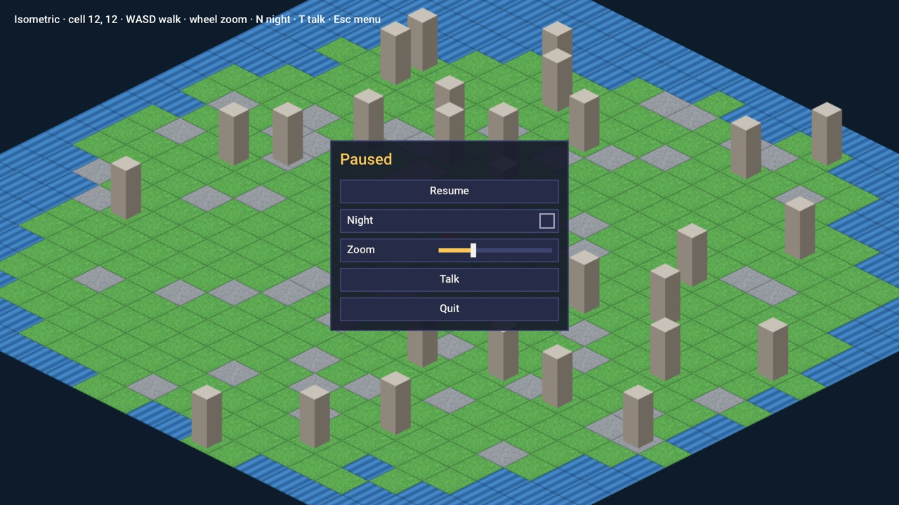
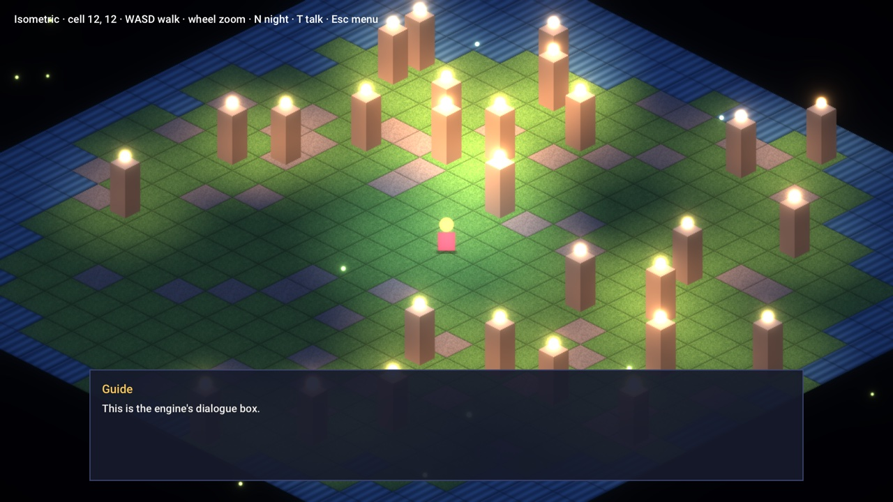

# Game UI

`ui::Context` draws menus, settings screens, HUD widgets and dialogue boxes for the game itself (the F1 overlay is
separate and uses Dear ImGui). It's *immediate mode*: each frame you call the widgets you want shown, and each call
returns what happened to it. There are no widget objects to create, keep in sync or destroy.

<p align="center"></p>

```cpp
#include "bowl/ui/ui.hpp"

ui::Context ui;              // keep it: it remembers focus and panel sizes between frames
gfx::SpriteBatch ui_batch;

void render(Engine& engine) {
    Vec2 screen = engine.window().size();
    ui_batch.begin(gfx::Camera2D::screen(screen), gfx::SpriteSort::None);
    ui.begin(ui_batch, engine.input(), screen, engine.delta(), engine.window().pixel_density());

    if (ui.begin_panel("pause", {screen.x * 0.5f - 170, 120, 340, 0})) {
        ui.label("Paused", ui.style.accent, 26);
        if (ui.button("Resume")) paused = false;
        ui.checkbox("Fullscreen", fullscreen);
        ui.slider("Music", music_volume, 0, 1);
        if (ui.button("Quit")) engine.quit();
        ui.end_panel();
    }

    ui.end();
    engine.renderer().submit_ui(ui_batch);
}
```

Set `ui.style.font` once before using the UI; nothing with text draws without a font.

The UI draws into a batch that *you* begin, with a screen camera and `SpriteSort::None` so things draw in call order.
You can draw your own HUD into the same batch before or after the widgets. Submit it with `submit_ui` so lighting and
post-processing don't touch it.

## Widgets

| Call | Returns |
| --- | --- |
| `begin_panel(id, rect)` / `end_panel()` | A panel; widgets inside are laid out top to bottom. `rect.h = 0` sizes it to its contents |
| `label(text, color, size)` | Text. Pass a zero color or size for the style's defaults |
| `button(text)` | `true` the update it's pressed |
| `checkbox(text, value)` | `true` when toggled; updates `value` |
| `slider(text, value, min, max)` | `true` while changed; updates `value` |
| `progress(fraction, fill)` | A bar filled to `fraction` (0..1) |
| `space(height)` | Vertical gap |
| `dialogue(speaker, typewriter)` | A dialogue box; see [below](#dialogue) |

Widgets are identified by their text within their panel, so two buttons both labeled "OK" in one panel would share
state; give them different text.

`ui.wants_pointer()` is `true` when the mouse is over the UI this frame. Check it before treating a click as a game
action, so clicking a button doesn't also fire a gun.

## Keyboard and gamepad

Every widget works without a mouse. The UI keeps a focus: up and down move it through the widgets in the order they
were drawn, confirm presses the focused button or toggles the checkbox, left and right move sliders. It reads the
actions `ui_up`, `ui_down`, `ui_left`, `ui_right`, `ui_confirm` and `ui_back`. If the game hasn't bound them, the UI
binds these the first time it runs:

| Action | Keys | Gamepad |
| --- | --- | --- |
| `ui_up` / `ui_down` / `ui_left` / `ui_right` | arrows, WASD | d-pad, left stick |
| `ui_confirm` | Enter, Space | South (A / Cross) |
| `ui_back` | Escape | East (B / Circle) |

`ui.back_pressed()` is `true` when back was pressed this frame: the natural place to close a menu.

```cpp
if (ui.back_pressed()) menu_open = !menu_open;
```

## Styles

`ui.style` controls the look:

| Field | |
| --- | --- |
| `font`, `font_size` | Text |
| `padding`, `spacing`, `widget_height` | Layout, in logical pixels |
| `text`, `text_dim`, `accent` | Text colors |
| `panel`, `border` | Panel fill and outline |
| `widget`, `widget_hover`, `widget_active` | Button and track colors |
| `panel_texture`, `panel_insets` | Nine-slice art for panels and widgets (see below) |

### Nine-slice art

To use drawn frames instead of flat colors, give the style a texture and the size of its borders in pixels (left,
top, right, bottom):

```cpp
ui.style.panel_texture = panel_art.get();
ui.style.panel_insets = {12, 12, 12, 12};
```

Corners stay their size; edges stretch along one axis and the middle along both. The fill color tints the texture.

## Dialogue

`ui.dialogue` draws a box across the bottom of the screen with a speaker's name and text that appears a character at
a time. It returns `true` when the player confirms after the text has finished, which is when to show the next line.
Confirming (or clicking) while the text is still appearing shows it all at once.

<p align="center"></p>

```cpp
ui::Typewriter line;
std::vector<std::string> script = {"The tide's out early.", "Best gather what you can before it turns."};
usize at = 0;

// to start:
line.start(script[0]);

// every frame, between ui.begin and ui.end:
if (talking && ui.dialogue("Guide", line)) {
    if (++at < script.size()) line.start(script[at]);
    else talking = false;
}
```

`line.chars_per_second` sets the speed (40 by default). The isometric sample's `--dialogue` flag starts a
conversation.

## Tips

- Build a menu as a [scene](scenes.md) with `transparent()` returning true, so the game shows behind it.
- Pause the game under a menu with `engine.set_paused(true)`, or don't update gameplay while it's open.
- Keep the `ui::Context` alive as long as the screen is: it carries focus and panel sizes from frame to frame.
- Text in widgets is rasterized at the screen's pixel density, so pass `window().pixel_density()` to `begin`.
