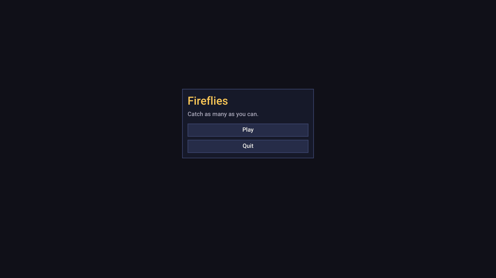

# Tutorial: Fireflies

This tutorial builds a small, complete game: you walk around a dark field catching fireflies. Along the way it uses
most of what the engine offers: the game loop, input actions, the ECS and parallel systems, collision, text, 2D
lighting and bloom, particles, sound, scenes, a menu and saved settings.

<p align="center"></p>

The finished code is the `tutorial` sample, [samples/tutorial/main.cpp](../samples/tutorial/main.cpp), and CI builds
it on every push. If a step here ever disagrees with that file, the file is right. Each step shows only what changes;
there's a full listing at the [halfway point](#checkpoint-the-whole-file-so-far).

You should have built the engine once already ([getting-started.md](getting-started.md)).

- [1. A project and an empty window](#1-a-project-and-an-empty-window)
- [2. Draw something](#2-draw-something)
- [3. A player that moves](#3-a-player-that-moves)
- [4. Fireflies, with the ECS](#4-fireflies-with-the-ecs)
- [5. Walls](#5-walls)
- [6. Catching fireflies](#6-catching-fireflies)
- [Checkpoint: the whole file so far](#checkpoint-the-whole-file-so-far)
- [7. A score on screen](#7-a-score-on-screen)
- [8. Night](#8-night)
- [9. Sparks](#9-sparks)
- [10. Sound](#10-sound)
- [11. A title screen](#11-a-title-screen)
- [12. Remember the best score](#12-remember-the-best-score)
- [Where to go next](#where-to-go-next)

## 1. A project and an empty window

Make a folder for the game next to the engine checkout:

```
games/
  Bowl/      the engine repository
  fireflies/
    CMakeLists.txt
    main.cpp
    assets/                 empty for now
```

`CMakeLists.txt` adds the engine as a subdirectory and declares the game:

```cmake
cmake_minimum_required(VERSION 3.25)
project(fireflies LANGUAGES C CXX)

add_subdirectory(../Bowl engine)

add_executable(fireflies main.cpp)
bowl_add_game(fireflies ASSETS assets)
```

`bowl_add_game` links the engine, compiles any shaders in `assets/`, and sets up the folders the game reads its assets
from. In a dev build, assets are read straight from your `assets/` folder, so saving a file there updates the running
game. ([reference/cmake.md](reference/cmake.md) has the details, including how to fetch the engine with
`FetchContent` instead.)

`main.cpp` starts as the smallest possible game:

```cpp
#include "bowl/app/main.hpp"

using namespace bowl;

class FirefliesGame final : public Game {
public:
    AppConfig configure() override {
        AppConfig config;
        config.window.title = "Fireflies";
        return config;
    }
};

BOWL_MAIN(FirefliesGame)
```

`BOWL_MAIN` provides the program's entry point. The engine owns the main loop and calls your `Game` back: `configure`
first, then `init` and `start` once, then `fixed_update`, `update` and `render` every frame.
[guides/game-loop.md](guides/game-loop.md) covers them all.

Build and run it:

```bash
cmake -B build -DCMAKE_BUILD_TYPE=RelWithDebInfo
```

```bash
cmake --build build --parallel
```

```bash
./build/fireflies
```

You get an empty window. Press F1: the dev overlay opens, with a frame-time graph, the profiler and panels you'll use
later.

## 2. Draw something

Everything 2D is drawn through a `gfx::SpriteBatch`: begin it with a camera, add sprites, and submit it to the
renderer. Batches are cheap to fill, so you fill them again every frame.

```cpp
class FirefliesGame final : public Game {
public:
    // ... configure() as before

    void render(Engine& engine) override {
        scene_.begin(engine.camera());
        scene_.draw_rect({-420, -240, 840, 480}, Color::hex(0x2f5a3a));
        engine.renderer().submit(scene_);
    }

private:
    gfx::SpriteBatch scene_;
};
```

The engine's camera starts centered on the window. Center it on the world origin instead, so the field is in the
middle:

```cpp
    void start(Engine& engine) override {
        engine.camera().position = {0, 0};
    }
```

`start` runs once, after `init`; it's where the world gets created. Coordinates are in logical points with y pointing
down; see [reference/conventions.md](reference/conventions.md).

## 3. A player that moves

**Input actions.** Rather than checking keys directly, bind named actions to keys and gamepad inputs once, then ask
about the action. Players can rebind actions later without the game changing.

```cpp
    void init(Engine& engine) override {
        Input& input = engine.input();
        input.bind("left", {InputBinding::key(Key::A), InputBinding::key(Key::Left), InputBinding::axis(GamepadAxis::LeftX, -1)});
        input.bind("right", {InputBinding::key(Key::D), InputBinding::key(Key::Right), InputBinding::axis(GamepadAxis::LeftX, +1)});
        input.bind("up", {InputBinding::key(Key::W), InputBinding::key(Key::Up), InputBinding::axis(GamepadAxis::LeftY, -1)});
        input.bind("down", {InputBinding::key(Key::S), InputBinding::key(Key::Down), InputBinding::axis(GamepadAxis::LeftY, +1)});
    }
```

**Components.** The player is an entity, and its data lives in components, which are plain structs. Put these above
the game class:

```cpp
struct Position {
    Vec2 value;
    Vec2 previous; // value at the previous fixed tick, so drawing can interpolate
};
BOWL_COMPONENT(Position, value, previous)

struct Player {
    f32 radius = 16;
};
BOWL_COMPONENT(Player, radius)
```

`BOWL_COMPONENT` is optional. It lists the fields so the engine can save the component, show it in the F1 inspector and
keep it across hot reloads. Any struct can be a component without it.

Create the player in `start`, and keep its id:

```cpp
    void start(Engine& engine) override {
        engine.camera().position = {0, 0};
        player_ = engine.world().create(Position{}, Player{});
    }

private:
    ecs::Entity player_;
```

**Movement.** Gameplay goes in `fixed_update`, which runs at a fixed 60 ticks per second no matter the frame rate, so
the game behaves the same on every machine. `input.vector` combines four actions into a direction, with a dead zone
for sticks:

```cpp
    void fixed_update(Engine& engine, f32 dt) override {
        Position& me = engine.world().get<Position>(player_);
        me.previous = me.value;
        me.value += engine.input().vector("left", "right", "up", "down") * (280.0f * dt);
    }
```

**Drawing it smoothly.** Frames don't line up with fixed ticks: a 144 Hz screen draws between ticks. `engine.alpha()`
says how far the current frame is between the last two ticks (0 to 1), so drawing at
`lerp(previous, value, alpha)` gives smooth motion at any refresh rate:

```cpp
    void render(Engine& engine) override {
        scene_.begin(engine.camera());
        scene_.draw_rect({-420, -240, 840, 480}, Color::hex(0x2f5a3a), -1e6f);

        const Position& p = engine.world().get<Position>(player_);
        Vec2 me = lerp(p.previous, p.value, engine.alpha());
        f32 r = engine.world().get<Player>(player_).radius;
        scene_.draw_rect(Rect::from_center(me, Vec2{r * 2}), Color::hex(0xffcf5c), me.y);

        engine.renderer().submit(scene_);
    }
```

The last argument of `draw_rect` is the depth. Batches sort by depth by default, lowest first. Using y as the depth
draws things lower on screen in front, which is what a top-down game wants; the ground gets a depth far below any y
so it's always underneath.

Run it and walk around with WASD, the arrow keys or a gamepad.

## 4. Fireflies, with the ECS

Fireflies are entities too: a `Position` and a `Firefly` component.

```cpp
struct Firefly {
    f32 heading = 0; // radians
    f32 turn = 0;    // radians per second
    f32 speed = 60;  // units per second
};
BOWL_COMPONENT(Firefly, heading, turn, speed)
```

**Resources.** The size of the field and a random number generator are needed in several places. Values that exist
once per world are *resources*: typed singletons stored on the world.

```cpp
struct Arena {
    Rect bounds{-420, -240, 840, 480};
};

// A tiny deterministic random generator, shared through the world.
struct Random {
    u32 state = 12345;
    f32 next() {
        state = state * 1664525u + 1013904223u;
        return static_cast<f32>(state >> 8) / 16777216.0f;
    }
    f32 range(f32 lo, f32 hi) { return lo + (hi - lo) * next(); }
};
```

Add them in `init`, and replace the hard-coded rectangle in `render` with `world.resource<Arena>().bounds`:

```cpp
        engine.world().set_resource<Arena>();
        engine.world().set_resource<Random>();
```

A helper spawns one firefly at a random spot:

```cpp
constexpr int firefly_count = 14;

void spawn_firefly(ecs::World& world) {
    Random& rng = world.resource<Random>();
    const Rect& a = world.resource<Arena>().bounds;
    Vec2 at{rng.range(a.x, a.right()), rng.range(a.y, a.bottom())};
    world.create(Position{at, at}, Firefly{rng.range(0, tau), rng.range(-1.5f, 1.5f), rng.range(40, 110)});
}
```

Call it `firefly_count` times in `start`.

**Systems.** Fireflies move on their own, which is a job for systems: functions the engine runs over every entity
with a given set of components. Register them once, in `init`, on the fixed schedule (it runs every tick, just before
`fixed_update`):

```cpp
        auto& fixed = engine.fixed_schedule();
        fixed.par_each<Position>("remember position", [](Position& p) { p.previous = p.value; });
        fixed.par_each<Position, Firefly>("wander", [](ecs::SystemContext& ctx, ecs::Entity, Position& p, Firefly& f) {
            const Rect& a = ctx.world.resource<Arena>().bounds;
            f.heading += f.turn * ctx.dt;
            p.value += Vec2::from_angle(f.heading) * (f.speed * ctx.dt);
            if (!a.contains(p.value)) { // turn around at the edge
                f.heading += pi;
                p.value = {clamp(p.value.x, a.x, a.right() - 1), clamp(p.value.y, a.y, a.bottom() - 1)};
            }
        }).reads_resource<Arena>();
```

`par_each` splits the entities across worker threads. That's safe because each call only touches its own entity's
components and reads shared data. The types in the angle brackets tell the scheduler what each system reads and
writes (a `const` type is read-only), so it knows these two systems both write `Position` and must run one after the
other. `.reads_resource<Arena>()` declares the resource read in the same way. See
[guides/systems.md](guides/systems.md).

The "remember position" system now handles `previous` for every entity with a `Position`, the player included, so
delete `me.previous = me.value;` from `fixed_update`.

**Drawing.** `world.each` visits every entity with the listed components. Draw the fireflies with the renderer's
built-in soft round texture:

```cpp
        const gfx::Texture& glow = engine.renderer().light_texture();
        f32 alpha = engine.alpha();
        engine.world().each<const Position, const Firefly>([&](const Position& p, const Firefly&) {
            Vec2 at = lerp(p.previous, p.value, alpha);
            scene_.draw(glow, {.position = at, .size = {12, 12}, .depth = at.y, .color = {0.9f, 1.0f, 0.5f, 1}});
        });
```

Open the overlay with F1 and expand **Systems**: both systems are listed with their timings. **Entities** lists every
entity; click one to see its components and edit them live.

## 5. Walls

The player can walk off the field. `physics::move_and_slide` moves a box by a distance, sliding along anything solid
instead of stopping dead, and never tunnels through thin walls. It asks a callback for the solid boxes near the
move:

```cpp
#include "bowl/physics/collision.hpp"
```

```cpp
    void fixed_update(Engine& engine, f32 dt) override {
        ecs::World& world = engine.world();
        Position& me = world.get<Position>(player_);
        const f32 radius = world.get<Player>(player_).radius;

        Vec2 move = engine.input().vector("left", "right", "up", "down") * (280.0f * dt);
        const Rect& a = world.resource<Arena>().bounds;
        auto walls = [&](const Rect&, FunctionRef<void(const Rect&)> emit) {
            emit({a.x - 64, a.y - 64, a.w + 128, 64}); // top
            emit({a.x - 64, a.bottom(), a.w + 128, 64}); // bottom
            emit({a.x - 64, a.y, 64, a.h});           // left
            emit({a.right(), a.y, 64, a.h});          // right
        };
        Rect box = Rect::from_center(me.value, Vec2{radius * 2});
        physics::move_and_slide(box, move, walls);
        me.value = box.center();
    }
```

For a tilemap you'd pass `physics::GridSolids` instead, which reports solid cells; see
[guides/collision.md](guides/collision.md).

## 6. Catching fireflies

A firefly is caught when it's within reach of the player. Destroying an entity while a query is iterating isn't
allowed, because it would move other entities around in memory mid-loop. Instead, record the change in a command
buffer, `world.deferred()`, and the engine applies it after `fixed_update` returns.

Add this to the end of `fixed_update`:

```cpp
        int caught = 0;
        physics::Circle reach{me.value, radius + 6};
        world.each<const Position, const Firefly>([&](ecs::Entity e, const Position& p, const Firefly&) {
            if (!physics::contains(reach, p.value)) return;
            world.deferred().destroy(e);
            ++caught;
        });
        for (int i = 0; i < caught; ++i) spawn_firefly(world);
        score_ += caught;
```

with an `int score_ = 0;` member. A lambda passed to `each` can take the `ecs::Entity` as its first parameter when it
needs it.

### Checkpoint: the whole file so far

```cpp
#include "bowl/app/main.hpp"
#include "bowl/physics/collision.hpp"

using namespace bowl;

struct Position {
    Vec2 value;
    Vec2 previous; // value at the previous fixed tick, so drawing can interpolate
};
BOWL_COMPONENT(Position, value, previous)

struct Firefly {
    f32 heading = 0; // radians
    f32 turn = 0;    // radians per second
    f32 speed = 60;  // units per second
};
BOWL_COMPONENT(Firefly, heading, turn, speed)

struct Player {
    f32 radius = 16;
};
BOWL_COMPONENT(Player, radius)

struct Arena {
    Rect bounds{-420, -240, 840, 480};
};

struct Random {
    u32 state = 12345;
    f32 next() {
        state = state * 1664525u + 1013904223u;
        return static_cast<f32>(state >> 8) / 16777216.0f;
    }
    f32 range(f32 lo, f32 hi) { return lo + (hi - lo) * next(); }
};

constexpr int firefly_count = 14;

void spawn_firefly(ecs::World& world) {
    Random& rng = world.resource<Random>();
    const Rect& a = world.resource<Arena>().bounds;
    Vec2 at{rng.range(a.x, a.right()), rng.range(a.y, a.bottom())};
    world.create(Position{at, at}, Firefly{rng.range(0, tau), rng.range(-1.5f, 1.5f), rng.range(40, 110)});
}

class FirefliesGame final : public Game {
public:
    AppConfig configure() override {
        AppConfig config;
        config.window.title = "Fireflies";
        return config;
    }

    void init(Engine& engine) override {
        Input& input = engine.input();
        input.bind("left", {InputBinding::key(Key::A), InputBinding::key(Key::Left), InputBinding::axis(GamepadAxis::LeftX, -1)});
        input.bind("right", {InputBinding::key(Key::D), InputBinding::key(Key::Right), InputBinding::axis(GamepadAxis::LeftX, +1)});
        input.bind("up", {InputBinding::key(Key::W), InputBinding::key(Key::Up), InputBinding::axis(GamepadAxis::LeftY, -1)});
        input.bind("down", {InputBinding::key(Key::S), InputBinding::key(Key::Down), InputBinding::axis(GamepadAxis::LeftY, +1)});

        engine.world().set_resource<Arena>();
        engine.world().set_resource<Random>();

        auto& fixed = engine.fixed_schedule();
        fixed.par_each<Position>("remember position", [](Position& p) { p.previous = p.value; });
        fixed.par_each<Position, Firefly>("wander", [](ecs::SystemContext& ctx, ecs::Entity, Position& p, Firefly& f) {
            const Rect& a = ctx.world.resource<Arena>().bounds;
            f.heading += f.turn * ctx.dt;
            p.value += Vec2::from_angle(f.heading) * (f.speed * ctx.dt);
            if (!a.contains(p.value)) {
                f.heading += pi;
                p.value = {clamp(p.value.x, a.x, a.right() - 1), clamp(p.value.y, a.y, a.bottom() - 1)};
            }
        }).reads_resource<Arena>();
    }

    void start(Engine& engine) override {
        engine.camera().position = {0, 0};
        player_ = engine.world().create(Position{}, Player{});
        for (int i = 0; i < firefly_count; ++i) spawn_firefly(engine.world());
    }

    void fixed_update(Engine& engine, f32 dt) override {
        ecs::World& world = engine.world();
        Position& me = world.get<Position>(player_);
        const f32 radius = world.get<Player>(player_).radius;

        Vec2 move = engine.input().vector("left", "right", "up", "down") * (280.0f * dt);
        const Rect& a = world.resource<Arena>().bounds;
        auto walls = [&](const Rect&, FunctionRef<void(const Rect&)> emit) {
            emit({a.x - 64, a.y - 64, a.w + 128, 64});
            emit({a.x - 64, a.bottom(), a.w + 128, 64});
            emit({a.x - 64, a.y, 64, a.h});
            emit({a.right(), a.y, 64, a.h});
        };
        Rect box = Rect::from_center(me.value, Vec2{radius * 2});
        physics::move_and_slide(box, move, walls);
        me.value = box.center();

        int caught = 0;
        physics::Circle reach{me.value, radius + 6};
        world.each<const Position, const Firefly>([&](ecs::Entity e, const Position& p, const Firefly&) {
            if (!physics::contains(reach, p.value)) return;
            world.deferred().destroy(e);
            ++caught;
        });
        for (int i = 0; i < caught; ++i) spawn_firefly(world);
        score_ += caught;
    }

    void render(Engine& engine) override {
        ecs::World& world = engine.world();
        scene_.begin(engine.camera());
        scene_.draw_rect(world.resource<Arena>().bounds, Color::hex(0x2f5a3a), -1e6f);

        const gfx::Texture& glow = engine.renderer().light_texture();
        f32 alpha = engine.alpha();
        world.each<const Position, const Firefly>([&](const Position& p, const Firefly&) {
            Vec2 at = lerp(p.previous, p.value, alpha);
            scene_.draw(glow, {.position = at, .size = {12, 12}, .depth = at.y, .color = {0.9f, 1.0f, 0.5f, 1}});
        });

        const Position& p = world.get<Position>(player_);
        Vec2 me = lerp(p.previous, p.value, alpha);
        f32 r = world.get<Player>(player_).radius;
        scene_.draw_rect(Rect::from_center(me, Vec2{r * 2}), Color::hex(0xffcf5c), me.y);
        engine.renderer().submit(scene_);
    }

private:
    gfx::SpriteBatch scene_;
    ecs::Entity player_;
    int score_ = 0;
};

BOWL_MAIN(FirefliesGame)
```

## 7. A score on screen

Text needs a font. The engine ships Roboto under `engine/fonts/`, and any `.ttf` or `.otf` in your assets works the
same way. Load it once in `init`:

```cpp
#include "bowl/gfx/text.hpp"

#include <format>
```

```cpp
        font_ = engine.assets().load<gfx::Font>("engine/fonts/Roboto-Medium.ttf");
```

```cpp
    Asset<gfx::Font> font_;
    gfx::SpriteBatch hud_;
```

`Asset<T>` is a shared handle. If the file changes on disk, the engine reloads it and every handle sees the new data.

The HUD gets its own batch with a screen-space camera (world units equal logical pixels, origin at the top left),
submitted with `submit_ui` so later lighting and post-processing leave it alone. At the end of `render`:

```cpp
        if (!font_) return;
        hud_.begin(gfx::Camera2D::screen(engine.window().size()), gfx::SpriteSort::None);
        gfx::TextStyle style{.size = 22, .raster_scale = engine.window().pixel_density()};
        gfx::draw_text(hud_, *font_, std::format("Caught {}", score_), {24, 20}, style);
        engine.renderer().submit_ui(hud_);
```

`raster_scale` makes glyphs rasterize at the screen's real pixel density, so text stays sharp on high-DPI displays.
`SpriteSort::None` keeps submission order, which is what UI wants. More in [guides/text.md](guides/text.md).

## 8. Night

Fireflies need the dark. Three renderer features make that work:

- **2D lighting.** With `post().lighting` on, the scene is multiplied by the ambient color plus a light map. You draw
  lights into the light map like sprites, with `submit_light`.
- **HDR and bloom.** The scene is rendered in floating point, so colors can go above 1. With bloom on, those
  over-bright pixels glow.
- **Vignette.** Darkens the edges a little.

Turn them on at the end of `start`:

```cpp
        gfx::PostSettings& post = engine.renderer().post();
        post.lighting = true;
        post.ambient = {0.12f, 0.14f, 0.26f, 1};
        post.bloom = true;
        post.vignette = 0.4f;
```

In `render`, make the firefly dots brighter than white so they bloom, and give each firefly and the player a pool of
light. Light batches use additive blending:

```cpp
        lights_.begin(engine.camera(), gfx::SpriteSort::None, gfx::BlendMode::Additive);
        world.each<const Position, const Firefly>([&](const Position& p, const Firefly&) {
            Vec2 at = lerp(p.previous, p.value, alpha);
            scene_.draw(glow, {.position = at, .size = {12, 12}, .depth = at.y, .color = {2.2f, 2.6f, 0.9f, 1}});
            lights_.draw(glow, {.position = at, .size = {170, 170}, .color = {0.45f, 0.55f, 0.2f, 1}});
        });
        // ... draw the player as before, then:
        lights_.draw(glow, {.position = me, .size = {420, 420}, .color = {0.75f, 0.68f, 0.55f, 1}});
        engine.renderer().submit(scene_);
        engine.renderer().submit_light(lights_);
```

Add `lights_` next to the other batches. Every post-processing value can be tuned live in the overlay's
**Post & lighting** panel; copy the numbers you like back into code. [guides/rendering.md](guides/rendering.md)
explains the whole frame.

## 9. Sparks

A trail of sparks while the player moves, and a burst on every catch. `gfx::ParticleEmitter` is a component holding
particle settings and the live particles. Give the player one in `start`:

```cpp
#include "bowl/gfx/particles.hpp"
```

```cpp
        gfx::ParticleSettings sparks;
        sparks.rate = 40; // per second while emitting
        sparks.lifetime_min = 0.3f;
        sparks.lifetime_max = 0.8f;
        sparks.speed_min = 10;
        sparks.speed_max = 70;
        sparks.spread = pi; // any direction
        sparks.drag = 2;
        sparks.size_start = 7;
        sparks.size_end = 1;
        sparks.color_start = {2.4f, 2.0f, 0.8f, 1}; // over-bright: blooms
        sparks.color_end = {1.0f, 0.5f, 0.2f, 0};
        player_ = engine.world().create(Position{}, Player{},
                                        gfx::ParticleEmitter{.settings = sparks, .emitting = false});
```

In `fixed_update`, remember whether the player is moving (`moving_ = move.length() > 0;`) and burst when catching:

```cpp
        auto& emitter = world.get<gfx::ParticleEmitter>(player_);
        world.each<const Position, const Firefly>([&](ecs::Entity e, const Position& p, const Firefly&) {
            if (!physics::contains(reach, p.value)) return;
            world.deferred().destroy(e);
            emitter.system.burst(emitter.settings, p.value, 30);
            ++caught;
        });
```

Particles are visual only, so they step once per frame in `update`, from the player's drawn position:

```cpp
    void update(Engine& engine, f32 dt) override {
        auto& emitter = engine.world().get<gfx::ParticleEmitter>(player_);
        const Position& p = engine.world().get<Position>(player_);
        emitter.origin = lerp(p.previous, p.value, engine.alpha());
        emitter.emitting = moving_;
        gfx::update_particle_emitters(engine.world(), dt);
    }
```

And drawn in their own additive batch, after the scene:

```cpp
        sparks_.begin(engine.camera(), gfx::SpriteSort::None, gfx::BlendMode::Additive);
        gfx::draw_particle_emitters(world, sparks_, glow);
        engine.renderer().submit(sparks_);
```

## 10. Sound

Sounds are assets too: put a `.wav` or `.ogg` in `assets/` and `engine.assets().load<audio::Sound>("chime.ogg")`.
To keep the tutorial free of files, the sample synthesizes a short chime and registers it with `assets().add`:

```cpp
std::unique_ptr<audio::Sound> make_chime() {
    std::vector<f32> mono(static_cast<usize>(audio::Sound::sample_rate * 0.25f));
    for (usize i = 0; i < mono.size(); ++i) {
        f32 t = static_cast<f32>(i) / audio::Sound::sample_rate;
        f32 envelope = std::exp(-t * 14.0f);
        mono[i] = (std::sin(tau * 1320.0f * t) + 0.5f * std::sin(tau * 1980.0f * t)) * envelope * 0.3f;
    }
    return audio::Sound::from_mono(mono);
}
```

```cpp
        chime_ = engine.assets().add("generated/chime", make_chime());   // in init, with an Asset<audio::Sound> chime_
```

Play it for each catch, with a little pitch variation so repeats don't sound mechanical:

```cpp
        for (int i = 0; i < caught; ++i) {
            spawn_firefly(world);
            engine.audio().play(chime_, {.gain = 0.5f, .pitch = world.resource<Random>().range(0.9f, 1.2f)});
        }
```

[guides/audio.md](guides/audio.md) covers music, buses and controlling playing sounds.

## 11. A title screen

Games are usually several screens: a title, the game, a pause menu. Each screen can be a `Scene`, and the engine keeps
a stack of them. The top scene gets updates; `replace` swaps scenes with a fade.

<p align="center"></p>

Move the gameplay into a `PlayScene`. The callbacks keep their names and signatures; the setup that was in `start`
goes in `enter`, and `exit` cleans up so the title screen starts from an empty world:

```cpp
class PlayScene final : public Scene {
public:
    void enter(Engine& engine) override { /* load the font, make the chime, create the player and fireflies,
                                             set up post-processing: everything start() did */ }
    void exit(Engine& engine) override {
        std::vector<ecs::Entity> all;
        engine.world().each<const Position>([&](ecs::Entity e, const Position&) { all.push_back(e); });
        for (ecs::Entity e : all) engine.world().destroy(e);
        engine.renderer().post() = {};
    }
    void fixed_update(Engine& engine, f32 dt) override { /* as before */ }
    void update(Engine& engine, f32 dt) override { /* as before */ }
    void render(Engine& engine) override { /* as before */ }
};
```

Input bindings, resources and systems stay in the game's `init`: they're registered once and shared by every scene.
Add a "back" action there too:

```cpp
        input.bind("back", {InputBinding::key(Key::Escape), InputBinding::button(GamepadButton::East)});
```

The title screen uses the immediate-mode UI: call widgets every frame, and they return what happened. It works with
the mouse, keyboard and gamepad without extra code.

```cpp
#include "bowl/ui/ui.hpp"

class TitleScene final : public Scene {
public:
    void enter(Engine& engine) override {
        ui_.style.font = engine.assets().load<gfx::Font>("engine/fonts/Roboto-Medium.ttf");
    }

    void render(Engine& engine) override {
        Vec2 screen = engine.window().size();
        batch_.begin(gfx::Camera2D::screen(screen), gfx::SpriteSort::None);
        ui_.begin(batch_, engine.input(), screen, engine.delta(), engine.window().pixel_density());
        if (ui_.begin_panel("title", {screen.x * 0.5f - 170, screen.y * 0.5f - 130, 340, 0})) {
            ui_.label("Fireflies", ui_.style.accent, 34);
            ui_.label("Catch as many as you can.", ui_.style.text_dim);
            ui_.space(6);
            if (ui_.button("Play") && !engine.scenes().transitioning())
                engine.scenes().replace(std::make_unique<PlayScene>(), 0.3f);
            if (ui_.button("Quit")) engine.quit();
            ui_.end_panel();
        }
        ui_.end();
        engine.renderer().submit_ui(batch_);
    }

private:
    ui::Context ui_;
    gfx::SpriteBatch batch_;
};
```

During a fade, the scene being left is still drawn and still takes input, so the `transitioning()` check stops a
second click from queuing a second switch.

In `PlayScene::update`, go back to the title when "back" is pressed:

```cpp
        if (engine.input().pressed("back") && !engine.scenes().transitioning())
            engine.scenes().replace(std::make_unique<TitleScene>(), 0.3f);
```

`TitleScene` has to be declared before `PlayScene` can create one, and the other way around, so define
`PlayScene::update` after `TitleScene`, as the sample does.

Finally, the game's `start` pushes the first scene. The `--play` flag skips the title, which is handy while working
on gameplay:

```cpp
    void start(Engine& engine) override {
        if (engine.has_arg("--play")) engine.scenes().push(std::make_unique<PlayScene>());
        else engine.scenes().push(std::make_unique<TitleScene>());
    }
```

## 12. Remember the best score

`engine.settings()` stores player preferences as JSON in the operating system's per-user data folder, and writes them
when the game exits. It's a good fit for a high score:

```cpp
constexpr const char* best_key = "fireflies.best";
```

```cpp
        best_ = engine.settings().get(best_key, 0);           // PlayScene::enter and TitleScene::enter
```

```cpp
        if (score_ > best_) best_ = score_;                     // PlayScene::fixed_update
```

```cpp
        engine.settings().set(best_key, best_);                 // before leaving PlayScene
```

Show it on the title screen with `ui_.label(std::format("Best: {}", best_))`. For full save games (whole worlds,
not one number), see [guides/saving.md](guides/saving.md).

That's the whole game. Compare with [samples/tutorial/main.cpp](../samples/tutorial/main.cpp) if anything doesn't
line up.

## Where to go next

- Real art: [sprite sheets](guides/sprite-animation.md) from Aseprite, [maps](guides/tilemaps.md) from Tiled
- Your own look: [custom shaders](guides/shaders.md) and [materials](guides/rendering.md#materials)
- Change code without restarting: [game-code hot reload](guides/hot-reload.md#game-code)
- Save and load the world: [guides/saving.md](guides/saving.md)
- Ship it: [guides/packaging.md](guides/packaging.md)
